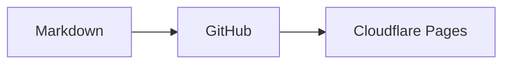

# Soohyuk blog content

이 폴더의 **내용 전체**를 새 공개 GitHub 저장소의 루트로 복사하세요. 숨김 폴더 `.github/`도 포함해야 합니다. 여기에 담긴 글은 작성 형식을 보여주기 위한 샘플이므로 실제 게시 전에 교체하거나 삭제하세요.

## 글 작성

`posts/` 아래에 `.md` 파일을 만듭니다. 디렉토리는 블로그의 폴더 분류로 표시되고, Markdown 파일 하나가 글 하나가 됩니다. 중첩 폴더와 한글 파일명을 지원합니다.

```markdown
---
title: "새 글의 제목"
slug: "a-permanent-address"
date: "2026-10-16"
description: "글을 소개하는 짧은 설명"
tags: [TypeScript, React]
draft: false
---

본문입니다. 인라인 수식 $E = mc^2$를 사용할 수 있습니다.

## 소제목

$$
f(x) = x^2
$$
```

- `title`, `slug`, `date`는 필수입니다. 날짜는 따옴표로 감싼 `YYYY-MM-DD` 형식으로 작성합니다.
- `slug`는 소문자 영문·한글·숫자와 단일 하이픈을 사용할 수 있으며, 저장소 전체에서 고유해야 합니다. 공개 후에는 유지하세요. 예: `/posts/a-permanent-address`.
- `description`을 생략하면 본문 텍스트에서 설명을 생성합니다.
- `tags`, `draft`, `updated`는 선택입니다. `updated`도 `YYYY-MM-DD` 형식입니다.
- 폴더명에는 `%`를 사용하지 않습니다. 태그에는 `/`, `\`, `%`를 사용하지 않습니다. 한글, 공백, `C#`, `C++` 같은 태그는 지원합니다.
- `draft: true`인 글은 블로그·검색·폴더·태그·RSS·sitemap에서 제외됩니다. 저장소 자체는 공개이므로 비밀 정보는 넣지 마세요.
- HTML과 JSX는 실행하지 않습니다. 표·체크리스트·취소선 등 GitHub Flavored Markdown을 지원합니다.
- `$...$`는 인라인 수식, `$$...$$`는 표시 수식입니다. 여러 줄 수식도 지원합니다. 리터럴 달러 기호는 `\$`로 작성합니다.

## Mermaid 다이어그램

언어를 `mermaid`로 지정한 코드 블록을 사용합니다.

````markdown

````

다이어그램은 브라우저에서 필요한 경우에만 렌더링하며 블로그의 라이트·다크 색상을 따릅니다. `accTitle`과 `accDescr`로 접근성 제목과 설명을 넣을 수 있습니다. 소스는 초기 HTML에 포함되며 JavaScript가 꺼져 있거나 렌더링이 실패하면 코드로 읽을 수 있습니다. 다이어그램 아래의 **다이어그램 소스**를 열어 원본도 확인할 수 있습니다. HTML 라벨과 클릭 명령은 비활성화되어 있습니다.

## 이미지와 링크

```text
posts/
  network/
    http.md
    images/
      cache.png
  react/
    state.md
```

`http.md`에서 이미지는 ``, 다른 글은 `[상태 관리](../react/state.md)`로 연결합니다. 참조한 파일은 빌드에서 검증하고 이미지 경로와 글 URL을 변환합니다. 링크에는 제목·설명과 다른 별도 설정이 필요하지 않습니다. HTTP/HTTPS 외부 링크와 문서 내 `#소제목` 링크도 지원합니다.

글을 다른 폴더로 이동해도 frontmatter의 slug를 유지하면 URL은 바뀌지 않습니다. 다른 글에서 그 파일을 참조하는 상대 경로는 함께 수정해야 합니다.

## 자동 업데이트

저장소의 **Settings → Secrets and variables → Actions**에 `CLOUDFLARE_PAGES_DEPLOY_HOOK`을 등록합니다. 값은 블로그 코드 저장소에 연결한 Cloudflare Pages 프로젝트에서 생성한, `main` 브랜치용 Deploy Hook URL입니다.

`main`의 `posts/**` 파일을 추가·수정·삭제하면 `.github/workflows/rebuild-pages.yml`이 Pages 빌드를 요청합니다. Actions 탭에서 수동으로 실행할 수도 있습니다. Actions의 성공은 **빌드 요청 성공**을 뜻하며, 실제 빌드·배포 결과는 Cloudflare Pages에서 확인합니다.
