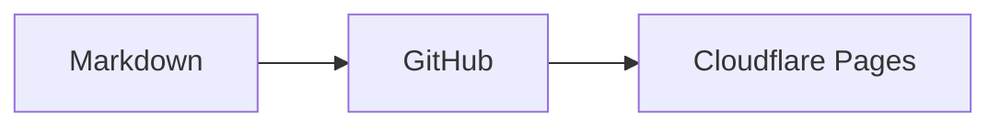

# Soohyuk blog content

이 폴더의 **내용 전체**를 새 공개 GitHub 저장소의 루트로 복사하세요. 숨김 폴더 `.github/`도 포함해야 합니다. 여기에 담긴 글은 작성 형식을 보여주기 위한 샘플이므로 실제 게시 전에 교체하거나 삭제하세요.

## 글 작성

`posts/` 아래에 `.md` 파일을 만듭니다. 디렉토리는 블로그의 폴더 분류로 표시되고, Markdown 파일 하나가 글 하나가 됩니다. 중첩 폴더와 한글 파일명을 지원합니다.

```markdown
---
title: "새 글의 제목"
slug: "a-permanent-address"
date: "2026-10-16"
description: "글을 소개하는 짧은 설명"
tags: [TypeScript, React]
draft: false
---

본문입니다. 인라인 수식 $E = mc^2$를 사용할 수 있습니다.

## 소제목

$$
f(x) = x^2
$$
```

- `title`, `slug`, `date`는 필수입니다. 날짜는 따옴표로 감싼 `YYYY-MM-DD` 형식으로 작성합니다.
- `slug`는 소문자 영문·한글·숫자와 단일 하이픈을 사용할 수 있으며, 저장소 전체에서 고유해야 합니다. 공개 후에는 유지하세요. 예: `/posts/a-permanent-address`.
- `description`을 생략하면 본문 텍스트에서 설명을 생성합니다.
- `tags`, `draft`, `updated`는 선택입니다. `updated`도 `YYYY-MM-DD` 형식입니다.
- 폴더명에는 `%`를 사용하지 않습니다. 태그에는 `/`, `\`, `%`를 사용하지 않습니다. 한글, 공백, `C#`, `C++` 같은 태그는 지원합니다.
- `draft: true`인 글은 블로그·검색·폴더·태그·sitemap에서 제외됩니다. 저장소 자체는 공개이므로 비밀 정보는 넣지 마세요.
- HTML과 JSX는 실행하지 않습니다. 표·체크리스트·취소선 등 GitHub Flavored Markdown을 지원합니다.
- `$...$`는 인라인 수식, `$$...$$`는 표시 수식입니다. 여러 줄 수식도 지원합니다. 리터럴 달러 기호는 `\$`로 작성합니다.

## Mermaid 다이어그램

언어를 `mermaid`로 지정한 코드 블록을 사용합니다.

````markdown

````

다이어그램은 브라우저에서 필요한 경우에만 렌더링하며 블로그의 라이트·다크 색상을 따릅니다. `accTitle`과 `accDescr`로 접근성 제목과 설명을 넣을 수 있습니다. 소스는 초기 HTML에 포함되며 JavaScript가 꺼져 있거나 렌더링이 실패하면 코드로 읽을 수 있습니다. 다이어그램 아래의 **다이어그램 소스**를 열어 원본도 확인할 수 있습니다. HTML 라벨과 클릭 명령은 비활성화되어 있습니다.

## 짧은 글

저장소 루트에 `posts/`와 나란히 `shorts/`를 만들고, 짧은 글 하나를 Markdown 파일 하나로 작성합니다. 파일명은 자유롭게 정할 수 있으며 `title`이나 `slug`는 필요하지 않습니다.

```markdown
---
date: "2026-10-28"
---

오늘 배운 점을 **짧게** 남깁니다.
```

링크를 함께 저장하려면 `link`와 선택 항목인 `linkTitle`을 추가합니다. 본문 없이 링크만 남겨도 됩니다.

```markdown
---
date: "2026-10-28T17:30:00+09:00"
link: "https://developer.mozilla.org/en-US/docs/Web"
linkTitle: "MDN Web Docs"
draft: false
---

다음에 다시 읽어볼 문서입니다.
```

- 필수 `date`는 따옴표로 감싼 `YYYY-MM-DD` 또는 시간대가 포함된 ISO 날짜·시간입니다. 예: `2026-10-28T17:30:00+09:00`, `2026-10-28T08:30:00Z`. 시간을 쓰면 한국 시간(KST)으로 표시하며, 날짜만 쓰면 해당 날짜를 그대로 표시합니다.
- `link`는 HTTP/HTTPS 절대 주소만 허용합니다. 빌드할 때 연결한 공개 페이지의 제목·설명·대표 이미지를 가져와 미리보기를 표시합니다. `linkTitle`이 있으면 해당 제목을 먼저 사용하고, 없으면 가져온 제목 또는 전체 주소를 표시합니다. 본문 안의 링크는 별도 카드로 변환하지 않습니다.
- 게시하는 글에는 본문 또는 `link` 중 하나가 있어야 합니다. 작성 중인 `draft: true` 초안은 본문·링크가 모두 비어 있어도 됩니다. 본문은 문단·강조·목록·인라인 코드 등 Markdown/GFM과 HTTP/HTTPS 링크, `/posts/...`처럼 `/`로 시작하는 블로그 링크를 지원합니다. HTML은 실행하지 않으며 본문 이미지·Obsidian 위키링크·수식·Mermaid 렌더링은 지원하지 않습니다. 본문 이미지는 제거되고 저장소 상대 파일 링크는 활성화하지 않습니다.
- `/shorts`의 **짧은 글** 화면에서 최신순으로 본문 전체를 읽습니다. 개별 상세 페이지는 생성하지 않으며 검색·최근 글 목록·폴더·태그의 글 수에 포함하지 않습니다. 날짜만 쓴 항목은 정렬할 때 한국 시간으로 해당 날짜의 시작으로 취급하며, 같은 시각에는 파일 경로 순으로 정렬합니다.
- `draft: true`인 짧은 글은 공개하지 않습니다. 파일명에서 `/shorts#...` 앵커를 생성하므로 게시 후 파일을 이동하거나 이름을 바꾸면 해당 앵커도 달라집니다.
- `shorts/`가 없어도 기존 콘텐츠는 정상 빌드되며 빈 화면을 표시합니다. 이 템플릿의 `shorts/hello.md`는 샘플이므로 실제 게시 전에 교체하거나 삭제하세요.

미리보기는 Open Graph(`og:*`), Twitter 메타데이터, 일반 HTML 제목·설명 순으로 확인합니다. 대표 이미지는 지원되는 PNG·JPEG·WebP·AVIF·GIF를 검증해 크기를 줄이고 로컬 WebP로 배포합니다(GIF는 첫 프레임). SVG와 너무 크거나 손상된 이미지는 사용하지 않습니다. 이미지를 가져오지 못해도 제목과 설명은 남고, 페이지 요청 자체가 실패하면 일반 링크로 표시합니다. 자동 요청을 차단하는 사이트나 메타데이터가 없는 사이트에서는 미리보기가 없을 수 있습니다.

미리보기는 브라우저에서 실시간 요청하지 않으며 다음 빌드에서 갱신합니다. 공개 HTTP/HTTPS의 기본 포트만 요청하고, 사설·예약 IP나 해당 주소로 연결되는 리다이렉트는 가져오지 않습니다. 요청 시간과 응답 크기를 제한하므로 링크 사이트의 지연이나 실패가 게시를 막지 않습니다. 초안의 링크는 요청하지 않습니다.

## 이미지와 링크

```text
images/
  Pasted image 20261028132609.png
posts/
  network/
    http.md
    images/
      cache.png
  react/
    state.md
```

`http.md`에서 이미지는 ``, 다른 글은 `[상태 관리](../react/state.md)`로 연결합니다. 이미지와 첨부 파일은 빌드에서 검증하고, 정상 글 링크는 대상의 slug URL로 변환합니다. 대상 글이 없거나 초안이면 표시 이름과 인라인 서식을 유지한 일반 텍스트로 남기며 경고를 출력하고 빌드는 계속합니다. 링크에는 제목·설명과 다른 별도 설정이 필요하지 않습니다. HTTP/HTTPS 외부 링크와 문서 내 `#소제목` 링크도 지원합니다.

이미지는 `posts/` 내부 또는 저장소 루트의 `images/`에 보관합니다. Obsidian 이미지 임베드 `![[Pasted image 20261028132609.png]]`, `![[images/Pasted image 20261028132609.png]]`, `![[posts/network/images/cache.png]]`를 지원합니다. 파일명만 쓰면 현재 글의 폴더를 먼저 찾고, 없으면 두 이미지 위치에서 일치하는 파일명·경로 접미사를 찾습니다. 후보가 여러 개이거나 파일이 없으면 원본 글 파일명과 함께 빌드 오류를 표시합니다.

`![[cache.png|설명]]`은 대체 텍스트를, `![[cache.png|300]]`과 `![[cache.png|300x200]]`은 양의 정수 픽셀 크기를 지정합니다. 크기를 지정하거나 별칭을 생략하면 파일명을 대체 텍스트로 사용합니다. PNG·JPEG·GIF·WebP·SVG·AVIF·APNG·BMP·ICO를 지원하며, 공백과 한글 파일명도 사용할 수 있습니다. 일반 Markdown으로 루트 이미지를 참조하려면 글 위치에 맞는 상대 경로를 씁니다. 예: `posts/network/http.md`에서 ``.

게시된 글에서 참조한 파일만 배포합니다. `posts/` 안의 첨부 파일은 `/content-assets/`, 루트 `images/`의 이미지는 `/content-images/`로 제공하므로 이름이 같아도 충돌하지 않습니다. 숨김 파일과 심볼릭 링크는 지원하지 않으며, 두 디렉토리 밖의 파일은 게시할 수 없습니다.

글을 다른 폴더로 이동해도 frontmatter의 slug를 유지하면 URL은 바뀌지 않습니다. 다른 글에서 그 파일을 참조하는 상대 경로는 함께 수정해야 합니다.

Obsidian 위키링크도 지원합니다. `[[state]]`, `[[state|상태 관리]]`, `[[react/state]]`, `[[posts/react/state.md]]`는 대상 파일의 slug URL로 변환합니다. `[[state#소제목]]`과 `[[#소제목]]`은 웹의 제목 앵커로 연결합니다. 문서는 frontmatter 제목이 아닌 **파일명**으로 찾습니다.

현재 폴더의 파일, `posts/` 기준 경로, 일치하는 파일명 또는 경로 접미사 순으로 찾습니다. 대상이 없거나 초안이면 `[[문서|표시 이름]]`의 표시 이름을, 별칭이 없으면 입력한 문서 대상을 일반 텍스트로 표시합니다. 원본 글 경로와 대상을 빌드 경고에 남기며 같은 글의 같은 대상은 중복해서 경고하지 않습니다. 후보가 여러 개인 모호한 링크는 폴더 경로를 명시해야 하며 계속 빌드 오류로 처리합니다. 안전하지 않은 경로와 누락된 이미지·첨부 파일도 오류로 남습니다. 코드·수식·기존 링크 안의 위키 문법과 백슬래시로 이스케이프한 예시는 변환하지 않습니다. `![[문서]]` 문서 임베드는 지원하지 않으며, `[[문서#^블록]]` 블록 링크는 빌드 오류로 알립니다.

## 자동 업데이트

저장소의 **Settings → Secrets and variables → Actions**에 `CLOUDFLARE_PAGES_DEPLOY_HOOK`을 등록합니다. 값은 블로그 코드 저장소에 연결한 Cloudflare Pages 프로젝트에서 생성한, `main` 브랜치용 Deploy Hook URL입니다.

`main`의 `posts/**`, `images/**`, `shorts/**` 파일을 추가·수정·삭제하면 `.github/workflows/rebuild-pages.yml`이 Pages 빌드를 요청합니다. 기존 콘텐츠 저장소를 사용한다면 workflow의 `paths`에도 `images/**`와 `shorts/**`를 추가해야 이미지나 짧은 글 변경만으로 재빌드됩니다. Actions 탭에서 수동으로 실행할 수도 있습니다. Actions의 성공은 **빌드 요청 성공**을 뜻하며, 실제 빌드·배포 결과는 Cloudflare Pages에서 확인합니다.
