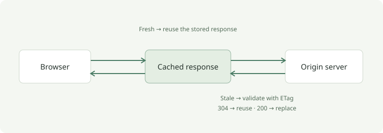
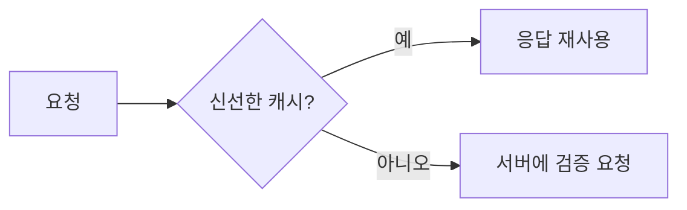
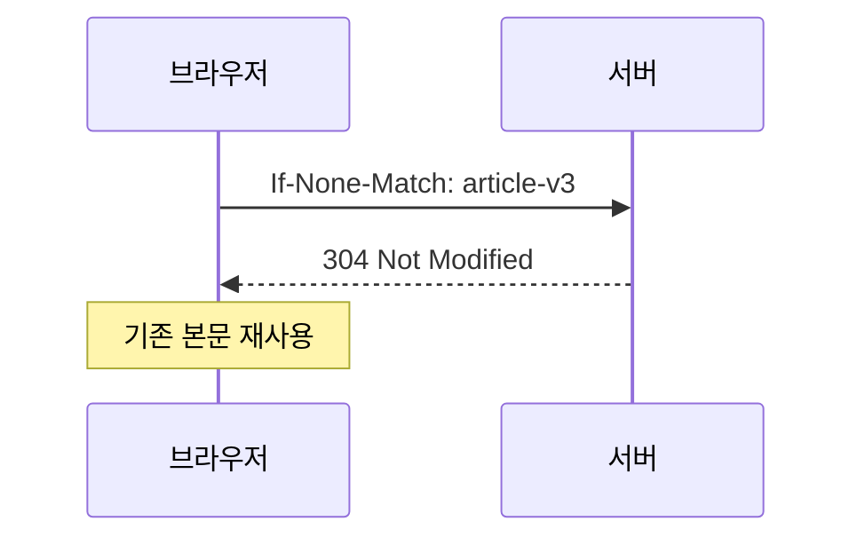

캐시를 이해할 때는 두 가지 질문을 나누면 편합니다. **이 응답을 저장할 수 있는가?** 그리고 **저장한 응답을 다시 사용해도 되는가?**

이 글은 블로그의 Markdown 표현과 코드 강조를 확인하기 위한 샘플입니다.

## 저장과 재사용은 다른 결정이다

`Cache-Control`은 응답을 저장하고 재사용하는 규칙을 전달합니다. 브라우저의 개인 캐시와 CDN 같은 공유 캐시는 같은 헤더를 읽지만, 적용하는 조건이 다를 수 있습니다.

| 지시어 | 의미 |
| --- | --- |
| `max-age=60` | 응답의 신선도를 60초로 지정 |
| `no-cache` | 재사용 전에 원본 서버에 검증 요청 |
| `no-store` | 응답을 캐시에 저장하지 않음 |
| `private` | 공유 캐시에 저장하지 않음 |

`no-cache`는 저장 자체를 금지하는 지시어가 아닙니다. 이름보다 **검증 후 재사용**이라는 동작을 기억하는 편이 정확합니다.

## 신선한 응답은 서버까지 가지 않는다

신선한 응답을 가진 캐시는 저장된 응답을 바로 사용할 수 있습니다. 브라우저 개발자 도구에서 메모리 캐시나 디스크 캐시로 표시되는 경우가 여기에 해당합니다.



```http
HTTP/1.1 200 OK
Cache-Control: public, max-age=60
ETag: "article-v3"
Content-Type: text/html; charset=utf-8
```

시간이 지나 응답이 만료되었다고 해서 저장된 응답이 곧바로 쓸모없어지는 것은 아닙니다. 서버에 변경 여부를 물어볼 수 있습니다.

## ETag로 변경 여부 확인하기

클라이언트는 저장해 둔 `ETag`를 `If-None-Match`에 담아 보냅니다. 서버는 표현이 같다면 `304 Not Modified`로 응답하고, 클라이언트는 보관한 본문을 사용합니다.





```typescript
const response = await fetch('/articles/http-cache', {
  headers: { 'If-None-Match': '"article-v3"' },
});

if (response.status === 304) {
  // 이전에 저장한 본문을 재사용합니다.
}
```

### 이름이 바뀌는 정적 파일

빌드 결과의 파일명에 콘텐츠 해시가 포함되어 있다면, 내용이 바뀔 때 URL도 바뀝니다. 이런 파일에는 긴 캐시 수명을 적용하기 좋습니다.

```http
Cache-Control: public, max-age=31536000, immutable
```

HTML처럼 주소는 유지하면서 내용이 바뀌는 파일은 별도의 정책을 고려해야 합니다.

## 확인할 것

- 요청 헤더와 응답 헤더를 함께 확인하기
- 브라우저 캐시와 공유 캐시를 구분하기
- `no-cache`와 `no-store`를 구분하기
- 개발자 도구의 캐시 비활성화 설정 확인하기

> 캐시 정책은 파일의 이름과 업데이트 방식을 함께 생각할 때 더 명확해집니다.

코드에서 상태를 구분하는 방법은 [TypeScript의 판별 유니온](../react/typescript/discriminated-unions.md)에도 정리해 두었습니다.
